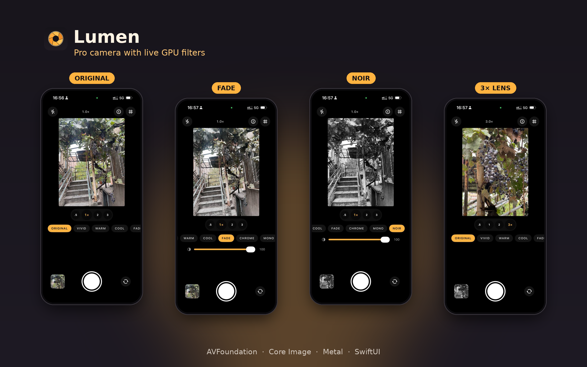
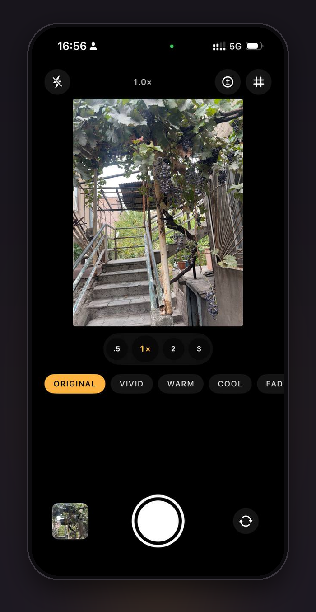
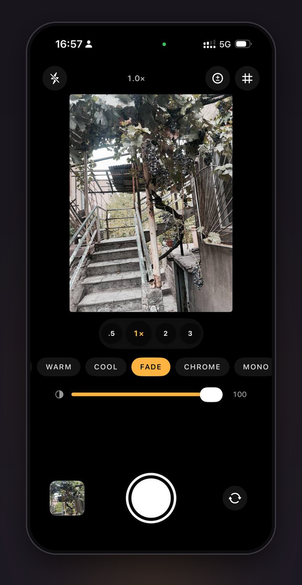
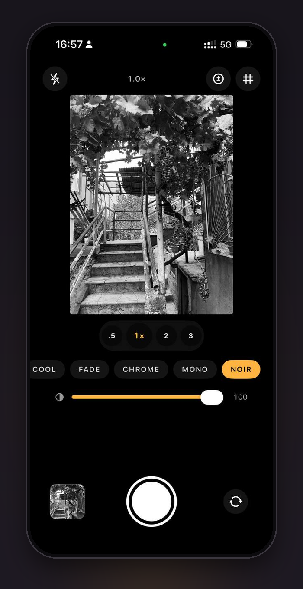
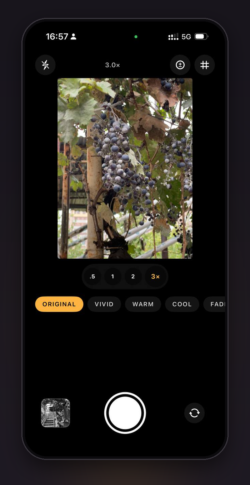
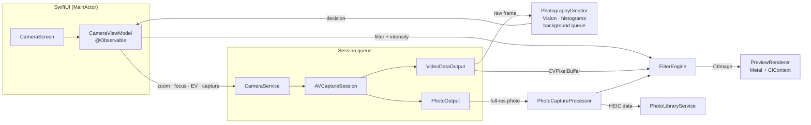

<p align="center">
  
</p>

<h1 align="center">Cam Z</h1>

<p align="center">
  <strong>Cam Z — AI Smart Photography</strong><br>
  <sub>POINT. SNAP. PERFECT.</sub>
</p>

<p align="center">
  A premium AI camera for iPhone that makes the photography decisions for you. It reads the scene, the light and the framing, and sets the camera up so one tap gets a great photo. Built on AVFoundation, Core Image and Metal.
</p>

<p align="center">
  
  
  
  
  
</p>

---

<p align="center">
  
</p>

## Screenshots

| Original | Fade | Noir | 3× lens |
|:--:|:--:|:--:|:--:|
|  |  |  |  |

<sub>These screenshots come from the original build the project started from. Cam Z screenshots will replace them after on-device capture.</sub>

## Features

- **Custom camera pipeline** — `AVCaptureSession` configured by hand (no `UIImagePickerController`), with the best available lens picked automatically (triple → dual → wide).
- **Live filters at 60 fps** — every frame is filtered with Core Image and drawn into an `MTKView` on the GPU.
- **What you see is what you save** — the preview and the full-resolution photo go through the *same* `FilterEngine`, so captures match the viewfinder exactly.
- **Adjustable intensity** — blend any look from 0–100 %.
- **Hold to compare** — press and hold to see the frame without the filter.
- **Hardware shutter** — the volume buttons (and Camera Control) take a photo, like the system Camera app (`AVCaptureEventInteraction`).
- **Lens shortcuts** — 0.5× / 1× / 2× / 3× that map to the real ultra-wide / wide / tele lenses on virtual devices, plus pinch-to-zoom.
- **Tap to focus & expose** with an aspect-fill-aware coordinate conversion.
- **Manual exposure compensation** (EV slider).
- **Flash** off / auto / on, **rule-of-thirds grid**, front/back camera switch.
- **Level photos in any orientation** — the UI stays in portrait, but `AVCaptureDevice.RotationCoordinator` rotates each capture to the horizon, so landscape shots come out landscape.
- **Metadata preserved** — filtered photos keep their EXIF/TIFF data (lens, exposure, date) with orientation corrected.
- **Interruption handling** — phone calls, another app using the camera or thermal pressure show a "Camera paused" state and recover automatically.
- **HEIC output** (JPEG fallback) saved to Photos with add-only permission.
- **Polish** — shutter animation, haptics, graceful permission & no-camera states, VoiceOver labels and adjustable actions.
- **Privacy first** — no tracking and no data collection, declared in a privacy manifest; Photos access is add-only.

### AI Photography Director (Auto mode, the default)

Auto reads each preview frame and sets the camera up for you:

- **Scene understanding** — portrait, food, architecture, landscape, night, indoor and outdoor, from Apple's on-device classifier plus face detection and brightness.
- **Exposure intelligence** — judges the subject's brightness rather than the frame's average, detects blown highlights and crushed shadows, and adjusts the exposure target bias. Setting exposure by hand locks it.
- **Lens and zoom** — chooses among the 0.5× / 1× / 2× / 3× presets the camera already offers.
- **Composition hints** — "Level the horizon" and off-centre subject prompts.
- **Capture timing** — watches for camera motion and focus or exposure changes, and waits up to 1.5 s for a steady preview before the shutter fires.

> Status: the decision logic has unit tests. Tuning on real scenes and lighting still needs on-device testing.

## Architecture



| Layer | Responsibility |
|---|---|
| `CameraControlling` / `PhotoSaving` | Protocols the view model depends on, so the whole UI logic is testable with mocks. |
| `CameraService` | Owns the capture session. All configuration runs on a private serial queue; frames arrive on a separate video queue. Exposes an `async` API to the UI. |
| `FilterEngine` / `FilterKind` | Pure, `Sendable` value types. One code path for live frames and stills. |
| `PreviewRenderer` | `MTKViewDelegate` that renders the latest `CIImage` with a Metal-backed `CIContext` and a `CIRenderDestination`. |
| `PhotoCaptureProcessor` | One delegate object per shot; applies the filter at full resolution and encodes HEIC. |
| `CameraMath` | Framework-free geometry (tap → point of interest, clamping) so it can be unit tested without a camera. |
| `CameraViewModel` | `@MainActor @Observable` state for the UI. |
| `PhotographyDirector` | Runs scene, exposure, lens and composition analysis on raw preview frames, off the camera and main threads, at about five analyses per second. Its decision modules (`ExposureAnalyzer`, `SceneClassifier`, `LensSelector`, `CompositionAnalyzer`, `CaptureDecisionEngine`) are pure and unit tested. |

### Design decisions

- **Metal preview instead of `AVCaptureVideoPreviewLayer`** — the preview layer can't show filtered frames. Rendering through Core Image on Metal keeps everything on the GPU with no CPU copies.
- **3:4 viewfinder** — matches the sensor's photo format, so the framing on screen is the framing in the photo.
- **Rotation and mirroring on the connection** (`videoRotationAngle`, `isVideoMirrored`) instead of per-frame transforms, which is cheaper and keeps filters orientation-agnostic.
- **Late frames are dropped** (`alwaysDiscardsLateVideoFrames`) and the renderer only keeps the newest frame, so a slow filter never builds latency.
- **Unfiltered shots keep the original file**, including all EXIF/location metadata.

## Tests

Unit tests cover everything that doesn't need camera hardware:

- `CameraViewModelTests` — the full UI logic against a `MockCamera`: permissions, lens presets, pinch zoom, filter/intensity, hold-to-compare, focus & exposure, flash, camera switching, capture success/failure and interruptions.
- `PhotoMetadataTests` — EXIF is kept, orientation reset, stale dimensions removed.
- `FilterEngineTests` — every filter preserves image size, intensity blending and clamping, mono really removes colour.
- `CameraMathTests` — tap-to-focus mapping for back/front cameras and cropped aspect-fill previews, zoom/EV clamping.
- `PreviewRendererTests` — aspect-fill scaling and centring.
- `PhotographyDirectorTests` — the AI decision logic: exposure judgement, scene rules, lens choice, composition hints, capture readiness, and a director pass on synthetic frames.

CI runs the full suite on every push via GitHub Actions.

## Getting started

Requirements: Xcode 15+, an iPhone on iOS 17+ (the Simulator has no camera).

```bash
brew install xcodegen      # once
git clone https://github.com/akhileshdasari2004/camz.git
cd camz
xcodegen                   # generates CamZ.xcodeproj
open CamZ.xcodeproj
```

Select your team under *Signing & Capabilities*, then run on a device.

Before running on a device, choose your own development team under *Signing & Capabilities* in Xcode. The bundle identifiers are set in `project.yml` (`bundleIdPrefix` plus the app and test IDs), and you can change them to any identifier you own. Signing needs an Apple account, and a free Apple ID can sign builds for your own iPhone.

## Roadmap

- [x] Live filters with adjustable intensity
- [x] Lens shortcuts, tap to focus, exposure, flash, grid
- [x] Level landscape captures and preserved metadata
- [x] Interruption handling
- [x] Hold to compare and hardware shutter button
- [x] AI Photography Director in Auto mode (scene, exposure, lens and composition analysis)
- [ ] On-device tuning of the AI director on varied scenes and lighting
- [ ] Video recording with filters (`AVAssetWriter`)
- [ ] ProRAW capture, manual shutter speed & ISO
- [ ] Custom LUT filters (`CIColorCube`)
- [ ] Swift 6 strict concurrency

## License

MIT — see [LICENSE](LICENSE). Cam Z is built on Lumen by Irena Poghosyan. The original copyright notice and MIT terms are kept unchanged in LICENSE.

## Author

Original project (Lumen): **Irena Poghosyan** — iOS developer · [GitHub](https://github.com/Irenapoghosian)
